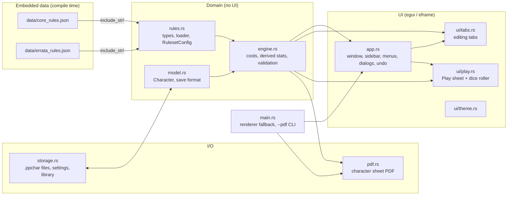

# PP Forge — Design

This document describes how PP Forge is built **as it is today**. Update it in the same pull request as any change that alters the architecture, the save format, the rules engine or the build. Related documents:

- [RULES_DATA.md](RULES_DATA.md): where the game rules data comes from and how it's produced.
- [DECISIONS.md](DECISIONS.md): why things are built the way they are.
- [SBOM.md](SBOM.md): third-party components and licenses (generated).
- [../README.md](../README.md): user-facing features, building, and rules interpretations.

## 1. Purpose and scope

PP Forge is a desktop application for building and running characters for **Prowlers & Paragons Ultimate Edition** (P&P UE). Each character is built under one of two rule sets, chosen per character:

| Ruleset | Meaning |
|---|---|
| **Core Rules (UE)** | The core rulebook as printed |
| **Core + Combined Errata** | The core rules with the *Combined Updates* document applied (adds Roles; revised Power list, costs, and Pros & Cons) |

Goals:

- **Runs anywhere:** one codebase for Windows, macOS and Linux. Each platform gets a single executable with no installer and no runtime files.
- **Correct by construction:** Hero Point costs, derived stats and legality checks are computed live from structured rules data, and the engine is unit-tested against examples from the book.
- **Usable at the table:** the Play tab has a clickable sheet and a dice roller; the PDF sheet is designed for paper.
- **The player's data stays the player's:** characters are plain JSON files in the user's Documents folder. There is no network access, no account and no telemetry.

Not goals (today): GM tools (NPC rosters, encounters), vehicles or headquarters builders, online sync, or reproducing the books' text.

## 2. Architecture



The domain modules (`rules`, `model`, `engine`) have no UI dependencies and carry most of the unit tests. The UI never computes costs itself: it edits a `Character`, and after every change the engine produces a fresh `Summary` that everything displays.

### 2.1 Source files

| File | Lines (approx.) | Responsibility |
|---|---|---|
| `src/main.rs` | 50 | Entry point. Tries the **wgpu** renderer first and falls back to **OpenGL (glow)**. `pp_forge --pdf in.ppchar out.pdf` exports a sheet without opening a window. Release builds on Windows hide the console window. |
| `src/rules.rs` | 460 | Rules data types (`PowerDef`, `ModDef`, `PerkDef`, `FlawDef`, `CostSpec`, `ModCost`, `RankSpec`). Loads both rulesets once (`OnceLock`), with name indexes. `RulesetConfig` holds rule differences that live in the books' prose rather than in tables (see §4.3). |
| `src/model.rs` | 570 | The `Character` and everything it contains, which is also the save-file schema. Ruleset conversion (`convert_to`). |
| `src/engine.rs` | 750 | Hero Point costs, Trait Caps, Edge/Health/Resolve, and validation `Issue`s. Pure functions over `&Character`. |
| `src/storage.rs` | 150 | Atomic save/load of `.ppchar` files, app settings, recent files, the library folder listing. |
| `src/pdf.rs` | 550 | US Letter character sheet using the PDF built-in Helvetica fonts, with its own text measuring and wrapping. |
| `src/app.rs` | 1020 | The `eframe::App`: open documents, undo/redo, menus, keyboard shortcuts, sidebar, Build Summary panel, modal dialogs, toasts, drag-and-drop. |
| `src/ui/tabs.rs` | 1060 | The Overview, Abilities & Talents, Powers (picker and editor), Perks & Flaws, Finishing Touches and Advancement tabs. |
| `src/ui/play.rs` | 940 | The Play tab: clickable sheet on the left, Challenge Roll roller on the right, roll history, session log. The dice logic is separate from the UI and unit-tested. |
| `src/ui/theme.rs` | 125 | Dark and light palettes, cards, badges, section titles. |

## 3. Data model and save format

A character is a `Character` struct serialized with `serde_json` as a pretty-printed `.ppchar` file:

```
Character
├─ format_version, ruleset (Core | Errata), char_type (Hero | Villain | Foe | Extra)
├─ power_level (Street … Iconic), role (errata only), package (None | Civilian | Hero | Superhero)
├─ abilities[6], talents[12]          TraitEntry { rank, source, mods[], note }
├─ powers[]                           PowerEntry { uid, def, descriptor, source, ranks, option, units,
│                                                  threat, base_trait, boost_cost, mods[], notes,
│                                                  cost_override, resolve_override, custom }
├─ perks[], flaws[]                   PerkEntry / FlawEntry (refer to rules data by name)
├─ awards[]                           Hero Point awards (advancement log)
├─ story                              names, motivation, descriptions, connections, details, origin, gear, notes
├─ options                            table options and GM overrides (cap mode, More Health, overrides…)
└─ play                               current Health/Resolve, Defining Moments, issues played, session log
```

Design rules:

- **References are by name, not copied.** A Power stores `def: "Blast"`, and the cost and behavior come from the ruleset's data at load time. A data fix therefore applies to existing characters automatically. A Power that doesn't exist in the character's ruleset is flagged instead of crashing the app. Custom Powers carry their own `PowerDef` in `custom`.
- **Forward and backward compatibility:** every struct uses `#[serde(default)]`, so older files with fields missing still load (there's a test for this). `format_version` is `1`, and loading a file with a newer version is refused with a clear message.
- **Atomic saves:** the file is written to `*.ppchar.tmp` and then renamed, so a crash can't leave a half-written file behind.
- **Stable identity:** `uid` and `next_uid` give Powers identities that stay the same when the list is reordered (used for the UI's expanded/collapsed state and the roller's selection).

Settings (theme, scale, recent files, library folder, default ruleset, reopen-on-launch) are separate JSON in the OS config directory, located with the `directories` crate (`ProjectDirs::from("org", "PPForge", "PP Forge")`). The character library defaults to `Documents/PP Forge/`.

## 4. Rules engine

### 4.1 Costs

`engine::evaluate(&Character) -> Summary` computes everything at once. Costs are tracked in **half Hero Points** so that "1 HP per 2 ranks" Powers and "+1 per 2 ranks" modifiers combine exactly. Each Power is rounded up once, at the end.

For each Power the engine:

1. Resolves the base `CostSpec`: per rank, per 2 ranks, flat, per power level, per unit, a choice (e.g. Omni-Power Narrow/Broad), or special. Boost costs the same as the Trait it boosts. Summoning costs ⌈Threat/2⌉ per rank in the core book and Threat/2 per rank in the errata. A modifier can **replace** the base cost (`override_cost`, e.g. the errata's Strike *Parrying*: 1 per 2 ranks becomes 1 per rank).
2. Applies Pros and Cons: flat, per rank, per 2 ranks, per power level, choice/range (the player picks the value), repeatable (×count). `Overkill`/`Weak` lower the per-rank cost by 1.
3. Computes the rank: Power Rank uses the purchased ranks. Baseline Rank uses the baseline plus purchased ranks, where the baseline can be a Trait, half a Trait, an average of two Traits, a fixed value, a choice, or another Power's final rank, resolved recursively with a depth limit.
4. Enforces the minimum: no Power costs less than 1 HP (or 1 HP per 2 ranks), unless the book lists it at 0 HP.
5. Applies the GM `cost_override` last.

Abilities and Talents cost 1 HP per rank above the package baseline and can carry generic modifiers (e.g. Overkill on Might). Perks are flat, per unit, a choice, or per power level. Flaws beyond the third cost 3 HP each.

### 4.2 Derived characteristics

| Stat | Rule implemented |
|---|---|
| **Trait Cap** | From power level; *Floating* adds +1d per 10 HP earned, *Soft* adds a GM bonus; errata *Overkill* raises that Trait's cap by 3d |
| **Edge** | Perception (or Danger Sense) + the higher of Agility/Intellect (option: Agility/Willpower); Lightning Reflexes +6; at least Super Speed × 3 |
| **Health** | ⌈(Toughness + the higher of Might/Willpower) / 2⌉; *More Health* option uses the sum; Foes get half |
| **Resolve** (Heroes) | 2 × (Trait Cap − highest counted Ability/Power rank) + Determination + 1 per Plot Hook/Condition Flaw. Which Powers count comes from each Power's `affects_resolve` flag (with a per-Power override). Errata Shapeshifting adds to effective physical Abilities. |

### 4.3 Ruleset differences

Most differences between the rulesets are in the **data** (different Powers, costs and modifiers). The rest live in `RulesetConfig`:

| Setting | Core | Errata |
|---|---|---|
| Power level names | Low Level, Standard, High Level… | Low Power, Standard Power, High Power… |
| Roles | no | yes |
| Max Flaws (without GM approval) | 6 | none stated |
| Summoning cost | ⌈Threat/2⌉ per rank | Threat/2 per rank |
| Shapeshifting counts for Resolve | no | yes |
| Edge alternative wording | — | Agility *or Willpower* option |
| Power renames for conversion | Evasion ↔ Dodge, Power Absorption ↔ Absorption, Energy Form ↔ Form, Energy, … | (reverse) |

### 4.4 Validation

`Summary.issues` lists problems as **Error**, **Warning** or **Info**: overspending, Traits over the cap, values below the package minimum, Heroes with no Flaws, too many Flaws at creation, Powers missing from the ruleset, incompatible Pros (Armor Piercing with Penetrating or Precise), Gestalt without Alter Ego, Fast Healing with Regeneration, Specialty outside Street/Low games, excessive Summoning Threat, Unusual Looks with Frightening (errata), and unspent HP. Issues never block editing or saving: Rule Uno says the GM has the final word, so the app informs rather than enforces.

## 5. User interface

Built with **egui** (immediate mode) via **eframe**. The whole UI is redrawn every frame from the current state, which keeps the state model simple: there are no widget objects to keep in sync.

- **Layout:** menu bar, a left **sidebar** (open characters, library folder listing), a central **tab area**, and a right **Build Summary** panel (stat tiles, Hero Point budget, cost breakdown, Checks). The summary panel is hidden on the Play tab to give the sheet and roller room.
- **Documents:** each open character is a `Doc` holding the current `Character`, the last saved copy (for the unsaved marker), an undo/redo stack (edits within 700 ms are merged into one step, up to 200 steps) and its latest `Summary`. After every frame the app compares the character with the previous frame's copy, and on change pushes an undo step and re-runs the engine.
- **Tabs:** Overview · Abilities & Talents · Powers (searchable picker by group, expandable editors, generic and Power-specific Pros & Cons, custom Powers) · Perks & Flaws · Finishing Touches · Advancement · Play.
- **Play tab:** clicking any Ability, Talent, Power or Edge loads it into the roller. The roller covers: static (Easy … Godlike) or opposed Thresholds, modifiers, spending Resolve for dice, multiple-action penalties, half rank, the Role bonus with Resolve-paid exploding 6s, Defining Moments, "checking your swing", and automatic successes. Rerolls cost 1 Resolve and keep the better result. Results show narrative and traditional outcomes and attack damage. Roller state and roll history are **not** saved; anything sent with "Log" goes into the character's saved session log.
- **Interaction rules:** egui gives clicks to the widget registered last, so clickable containers (the sidebar character cards) register their click area first (`UiBuilder::sense`) and make their text non-selectable. Unsaved changes trigger a Save/Discard/Cancel prompt when you close a character or quit.
- **Theme:** a dark "inked page" palette with a comic-red accent, and a light variant. UI scale goes from 0.75 to 1.75.

## 6. PDF export

`pdf::render(&Character) -> Vec<u8>` lays out a US Letter sheet (215.9 × 279.4 mm) with `printpdf`, using the **PDF built-in Helvetica fonts**, so there are no font files to ship or find on each platform. The built-in fonts don't provide text measurement, so `pdf.rs` includes Helvetica's character widths and does its own word wrapping. Text is limited to WinAnsi characters, and other characters are replaced.

Page 1, top to bottom: header band (name, real name, type, power level, Role, motivation, ruleset badge, player) → derived-stat tiles → **In Play** write-in boxes (Current Health, Current Resolve, Defining Moments, Hero Points Unspent) → Abilities and Talents in two columns → Powers table grouped by Source → Perks → Flaws → Finishing Touches → Advancement. New pages are added as needed, with a footer on each.

## 7. Platforms, build and release

- **Language/toolchain:** Rust 2024 edition, minimum Rust **1.95** (required by egui/eframe 0.37). Dependencies are pinned in `Cargo.lock`, and CI builds with `--locked`.
- **Rendering:** wgpu (Vulkan/Metal/DX12) with an automatic fallback to OpenGL. File dialogs are native via `rfd` (the XDG desktop portal on Linux, with a fallback to the library folder when no portal is available).
- **CI** (`.github/workflows/build.yml`) runs on every push and pull request:
  - `build`: four runners (`ubuntu-latest`, `windows-latest`, `macos-latest` for Apple Silicon, `macos-15-intel`). Each runs tests, clippy with `-D warnings` and a release build, then packages the binary with the README and the sample character (`.zip` for Windows, `.tar.gz` elsewhere) as an artifact.
  - `sbom`: regenerates the SBOM and fails if the committed copy is out of date.
  - `release` (only for `v*` tags, after `build` and `sbom` both pass): publishes a GitHub Release with the four packages and four SBOMs.
- **Cross-compiling Windows from Linux:** the `x86_64-pc-windows-gnu` target with MinGW-w64 (see the README).
- **Repository workflow:** changes go through pull requests, so CI runs before anything is merged into `main`. Commits use the owner's GitHub noreply address, because the real address is private.

## 8. Testing

| Layer | How it's tested |
|---|---|
| Rules data | `rules::tests`: both rulesets load; key costs match the books (e.g. Regeneration 6 vs 12, Quick Change 3 vs 1, errata Strike per 2 ranks); every conversion rename target exists. Data build scripts reproduce the committed JSON byte for byte. |
| Engine | `engine::tests`: the core book's Chapter 2 walkthrough hero totals exactly 100 HP; baseline and per-2-rank math; errata Parrying cost replacement; minimum costs; Overkill cost and cap; Summoning cost in each ruleset; Edge/Health/Resolve against a published sample hero; every Power in both rulesets costs without panicking. |
| Model/storage | JSON round trip; old files with missing fields load; ruleset conversion renames; save/load in a temp folder; safe file names. |
| Dice | `play::tests`: success counting against the book's examples; pool modifiers (half rank rounds up, Defining Moment doubles, minimum 1 die); outcome table; exploding dice; automatic successes; rerolls never lower the result. |
| PDF | Renders valid PDFs for empty characters in both rulesets; visual check of the sample sheet. |
| GUI | Manual and automated visual checks: the app runs under Xvfb with software OpenGL, is driven with simulated mouse clicks (python-xlib XTEST), and screenshots are inspected. Simulated keystrokes don't reach egui text fields in that setup. Developer hooks: `PPFORGE_START_TAB`, `PPFORGE_PICKER`, `PPFORGE_DEMO_ROLL`. |

Run everything with `cargo test` and `cargo clippy --all-targets -- -D warnings`.

## 9. Security and privacy

- No network access at runtime, no telemetry, no auto-update.
- The only files read are the ones the user opens. Writes go to the library folder, the settings file, and the paths the user chooses.
- Every third-party component is pinned and checksummed, and the SBOM is published with each release (see [SBOM.md](SBOM.md)).
- Release binaries are **not code-signed**, so Windows SmartScreen and macOS Gatekeeper warn the first time they're run.

## 10. Open items

| Item | Notes |
|---|---|
| **Project license** | PP Forge declares no license yet (no `LICENSE` file, no `license` in `Cargo.toml`), so it is "all rights reserved" by default. The owner should choose one (e.g. MIT/Apache-2.0 to match the ecosystem), and then the SBOM picks it up. |
| Code signing | Unsigned Windows and macOS builds trigger security warnings. Signing needs a certificate (Windows) and an Apple Developer ID plus notarization (macOS). |
| macOS packaging | Releases ship a bare executable, not an `.app` bundle or `.dmg`. |
| Errata data verification | The errata data was entered by hand from the Combined Updates text. Its key values are tested, but it hasn't had the line-by-line automated cross-check the core data had (see [RULES_DATA.md](RULES_DATA.md#verification)). |
| Edge wording in the errata | The errata contradicts itself (Ch. 2: Agility/Intellect; Ch. 4: Agility/Willpower). The app defaults to Ch. 2, with an option for Ch. 4. |
| Roller persistence | Roller settings and roll history reset on restart; only logged rolls are saved. |
| Text-field automation | GUI tests can't type into fields under Xvfb, so text editing is tested by hand only. |
| Not modelled | Vehicles, Headquarters (Base Points), Pet/Sidekick and Alternate Form sub-characters (their costs are counted, but the sub-builds aren't), Minion/NPC rosters. |
